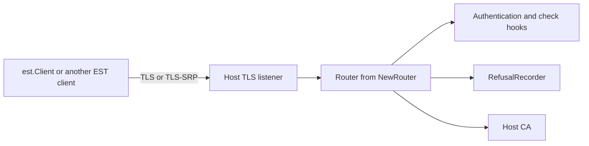

# Architecture

go-pki-est is a protocol layer. The client turns Go calls into EST requests. The server turns EST
requests into calls to a `CA` interface that your application implements. TLS, the CA itself, the
decision who may enroll and any storage stay with your application.

## Components

| Component | Provided by | Role |
| --- | --- | --- |
| `est.Client` | Library | Connects, signs in and runs one EST operation per call |
| TLS listener | Host | Terminates TLS or TLS-SRP and requests client certificates |
| Router | Library, built by `NewRouter` | Checks and decodes requests, checks renewals and encodes responses |
| `CA` | Host | Returns CA certificates and CSR attributes and issues certificates |
| `CheckBasicAuth`, `CheckBearerToken` | Host, optional | Decide who may enroll |
| `CheckCSRSignature`, `VerifyClientCertificate` | Host, optional | Replace signature checks that `crypto/x509` cannot do |
| `RefusalRecorder` | Host, optional | Receives the requests the router refuses itself |
| `Logger` | Host, optional | Receives one entry per request and the server errors |

The router is a plain `http.Handler`. You serve it with your own `http.Server`, next to other
handlers if you like. It reads the TLS state from `http.Request.TLS` and the TLS-SRP username from
the request context, where your listener puts it with `WithSRPUsername`.

## Request handling on the server

Every request passes these steps in order. A step that refuses the request answers at once.

1. A **timeout** of `ServerConfig.Timeout`, 60 seconds by default, bounds the request context.
2. A **request ID** is assigned. With `TrustProxyHeaders` the client address comes from
   `X-Real-IP` or `X-Forwarded-For`.
3. The **request is logged** when it completes. A **panic** in a handler or in the CA is recovered,
   logged with its stack and answered with 500.
4. The `Server`, `Strict-Transport-Security` and `X-Content-Type-Options` **headers** are set.
5. With `AllowedHosts`, the **Host header** must name an allowed host.
6. The **body** is limited to `MaxRequestBody`, 64 KiB by default.
7. With `RateLimit`, a **shared rate limiter** answers 429 when it is empty.
8. An **additional path segment** longer than 255 bytes answers 414.
9. For `POST` operations the **content type** must match the operation.
10. For `POST` operations and `/healthcheck`, **authentication** runs `CheckBearerToken` or
    `CheckBasicAuth`. See [Authentication](server/authentication.md).
11. The operation **decodes the body**, parses the CSR and checks its signature.
12. For `/simplereenroll` the **renewal checks** compare the request with the client certificate
    and verify that certificate.
13. The router **calls the CA** and encodes its answer or sends its error.

[Embedding the server](server/embedding.md) lists the endpoints. [Errors](reference/errors.md)
lists the status and message of each refusal.

## Request handling on the client

Each client method:

1. Picks a **proxy** from `Client.Proxy` or the environment and opens a TCP connection, through a
   `CONNECT` tunnel when a proxy applies.
2. Runs the **TLS handshake** with the trust anchors and client certificate or the **TLS-SRP
   handshake** with `SRPUsername` and `SRPPassword`. `OnConnect` then sees the connection.
3. For `Enroll` and `Reenroll` with `SigningKey` set, signs the CSR again with the `tls-unique`
   value of this connection as its challenge password. Only TLS 1.2, including TLS-SRP, has that
   value. Only an RSA or ECDSA `SigningKey` can sign the new request.
4. Sends one request with the Basic or bearer credentials and `AdditionalHeaders`, through
   `WrapTransport` when it is set.
5. Reads at most `MaxResponseBody` bytes, returns any status other than 200 as an `est.Error` and
   decodes the rest.

The connection is closed when the method returns. The client keeps no state between calls, so one
`Client` value can run any number of operations.

## What stays with the host

* **TLS.** The host chooses the server certificate, the TLS versions and which client certificates
  the handshake accepts.
* **The CA.** Signing, certificate profiles, revocation and any approval workflow are behind the
  `CA` interface.
* **Who may enroll.** Without `CheckBasicAuth` or `CheckBearerToken` every enrollment request is
  accepted.
* **Proof of possession.** The router does not check the `tls-unique` challenge password. A CA that
  needs the binding checks it.
* **Retries.** A CA that answers 202 with a `Retry-After` value does not get polled. The client
  returns the status and the value and the caller decides when to try again.
